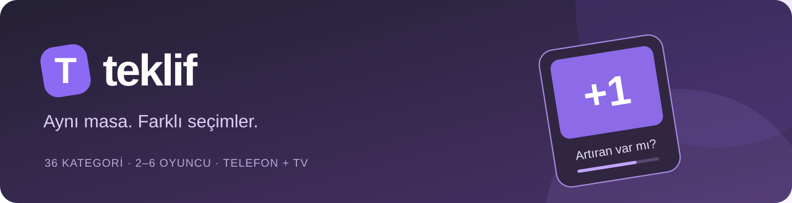
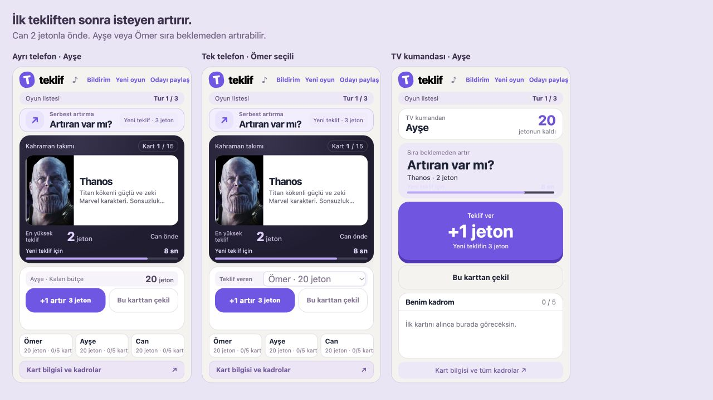

<p align="center">
  
</p>

<p align="center">
  <a href="https://github.com/OmerUzunsoy/Teklif/actions/workflows/test.yml"></a>
  
  
  
  
</p>

**Bütçen belli. Seçimlerin sana kalmış.** Teklif; ailenle ve arkadaşlarınla kahraman takımları, restoran menüleri, futbol kadroları ve daha fazlasını açık artırmayla kurduğun bir parti oyunu. Tek telefonda, aynı Wi-Fi’de ayrı cihazlarla veya ortak TV ekranıyla oynanır.

*An auction party game for 2–6 players, with 36 categories, phone controllers and a shared TV display. Built with vanilla JavaScript and Node.js.*

<p align="center">
  <a href="#hızlı-başlangıç">Oyunu başlat</a> ·
  <a href="docs/oyun-rehberi.md">Oyun rehberi</a> ·
  <a href="docs/gelistirme.md">Geliştirici rehberi</a> ·
  <a href="https://github.com/OmerUzunsoy/Teklif/issues">Fikir ve hata bildir</a>
</p>



## Nasıl oynanır?

1. Bir kategori seç. Herkese eşit jeton ve 3 ya da 5 kadro yeri verilir.
2. Sürpriz kart açılır. Açılış oyuncusu 1 jetonla başlar.
3. **İlk tekliften sonra sıra yok.** İsteyen +1 artırır; her yeni teklif sayacı yeniden başlatır.
4. Süre bittiğinde veya diğerleri çekildiğinde kart en yüksek teklif sahibinindir.
5. Kadroları karşılaştır. İsterseniz kazananı tartışın, isterseniz oyun puanlarını kullanın.

En yüksek teklif sahibi kendi teklifini artıramaz. Çekilen oyuncu o karta geri dönemez. Oyun, boş kadro yerleri için en az birer jeton ayırır. Tüm jetonlar oyun içidir.

## Aynı oyun, üç ekran düzeni

| Oynama biçimi | Nasıl çalışır? |
| --- | --- |
| **Tek telefon** | Aynı ekranı paylaşın; açılıştan sonra teklif verecek kişi ismini seçsin. |
| **Herkes kendi telefonunda** | Aynı Wi-Fi’de odaya bağlantı veya QR kodla katılın. Herkes kendi düğmesinden artırır. |
| **TV’de oyna** | Kart, teklifler ve sayaç TV’de; büyük teklif düğmesi ve kişisel kadro telefonlarda. |

## İçeride neler var?

- **36 kategori, 2.095 aktif görselli kart:** kahramanlar, futbol, F1, diziler, sinema, müzik, yemekler, markalar ve daha fazlası. Kartların kısa Türkçe tanıtımları bulunur.
- **Oyun listeleri ve oylamalı seriler:** kategorileri önceden sırala veya sonraki turu üç aday arasından seç. Tur puanları genel sıralamada birikir.
- **Tartışmalı veya puanlı final:** oda sahibi sıralamayı kaydeder; isteğe bağlı puanlı mod editoryal kart değerlerini toplar.
- **Ortak sayaç ve satış özeti:** kim aldı, kaç jetona aldı, kaç jetonu kaldı? İsteğe bağlı F/P yıldızları satın alma fiyatını değerlendirir.
- **Açılış jokeri:** ayarlardan açıldığında her oyuncu tur başına bir kez, kendi açılışından önce kartı değiştirebilir.
- **Sesler ve açılış bildirimi:** destekleyen cihazlarda titreşim; TV’de isteğe bağlı Türkçe sunucu sesi.
- **Sonuçları paylaş:** kadroları veya kurallarla birlikte hazırlanmış ChatGPT analiz promptunu kopyala.

## Hızlı başlangıç

Bilgisayarda **Node.js 22 veya üzeri** ve `curl` bulunmalı. Telefonlara uygulama kurulması gerekmez.

```sh
git clone https://github.com/OmerUzunsoy/Teklif.git
cd Teklif
npm start
```

Bağımlılık kurulumuna veya derleme adımına ihtiyaç yok. Bilgisayarda [localhost:4177](http://localhost:4177) adresini açın.

**Telefonlarla katılım:** bilgisayar ve telefonlar aynı Wi-Fi’de olsun. Başlatılan sunucunun gösterdiği yerel bağlantıyı telefonda açın. Odayı kurup katılım bağlantısını veya QR kodunu paylaşın. Bilgisayar oyun boyunca açık kalmalı.

**TV bağlantısı:** oda ayarlarında **TV’de oyna** seçeneğini açın. Odanın TV bağlantısını televizyonun tarayıcısında açın; alternatif olarak bilgisayarı HDMI ile TV’ye bağlayın.

**Mac kısayolu:** Node.js kuruluysa `Oyunu Aç.command` dosyası da oyunu başlatır.

### Görseller ve çevrimdışı kullanım

Görsellerin kaynak eşleştirmeleri repoda bulunur. Büyük görsel önbelleği repoya dahil değildir; yeni kurulumda görseller ilk görüntülendiklerinde internetten alınır ve `.runtime/images/` içine kaydedilir. Kaynak sitelerin erişilebilirliği değişebilir.

Tüm aktif kartları önceden indirmek için:

```sh
npm run images:cache
```

İndirme tamamlandıktan sonra yerel ağdaki oyun önbellekteki görsellerle internet olmadan kullanılabilir. Bu komut mevcut kart havuzunu değiştirmez; başarısız indirmeleri bildirir ve tekrar çalıştırılabilir.

## Geliştirme ve testler

```sh
npm test                 # Kendi geçici sunucusunu açar; gerçek odalara dokunmaz
npm run test:images      # Ek olarak tüm görsel önbelleğini doğrular
```

Temel testler görsel indirmeye ihtiyaç duymaz. Görsel testleri için önce önbelleği hazırlayın. macOS Vision ile bağımsız QR çözme testi, Swift araçları bulunan Mac’lerde çalışır; diğer ortamlarda bu test atlanır.

| Dosya / klasör | Sorumluluk |
| --- | --- |
| `dist/` | Düzenlenebilir tarayıcı kaynakları; derleme çıktısı olarak silmeyin. |
| `dist/engine.js` | Teklif, bütçe, sayaç, joker ve satış kuralları. |
| `dist/series.js` | Oyun listeleri, kategori oylaması ve genel sıralama. |
| `dist/auction-ui.js`, `dist/tv-ui.js` | Masa, telefon ve TV arayüzleri. |
| `server.mjs` | Odalar, katılım, ortak durum ve statik dosyalar. |
| `image-store.mjs` | Görsel indirme ve yerel önbellek. |
| `tests/` | Oyun kuralları, eşzamanlı teklifler, odalar, seriler ve görseller. |
| `docs/` | Ekran görüntüleri ve ayrıntılı rehberler. |

Ayrıntılar: [Geliştirici rehberi](docs/gelistirme.md) · [Katkı rehberi](CONTRIBUTING.md) · [Değişiklikler](CHANGELOG.md).

## Projenin durumu

Teklif, yerel ağda oynanan bir prototiptir. GitHub reposu kaynak kodunu paylaşır; çok oyunculu oyun Node.js sunucusu gerektirir. GitHub Pages tek başına oda sunucusunu çalıştırmaz. İnternet üzerinden herkese açık oyun hizmeti, kullanıcı hesapları veya uygulama mağazası yayını bu sürümde bulunmuyor.

Kart puanları ve F/P yıldızları editoryal oyun değerleridir. Gerçek dünya istatistikleri veya kesin karakter gücü ölçümü değildir. Varlık kaynakları ve üçüncü taraf kod bilgileri [THIRD_PARTY_NOTICES.md](THIRD_PARTY_NOTICES.md) içinde açıklanır.

**Fikir ve geliştirme:** [Ömer Uzunsoy](https://github.com/OmerUzunsoy).
